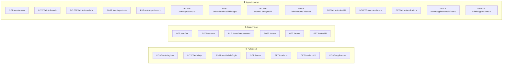

# API Endpoints для Backend — ChronoClassic Watch Store

> [!NOTE]
> Цей документ описує всі API-ендпоінти, необхідні для повноцінної роботи фронтенду проєкту ChronoClassic.`

---

## Зміст

1. [Аутентифікація та Сесії](#1-аутентифікація-та-сесії)
2. [Користувачі (Профіль)](#2-користувачі-профіль)
3. [Адміністратори](#3-адміністратори)
4. [Бренди](#4-бренди)
5. [Товари (Годинники)](#5-товари-годинники)
6. [Зображення товарів](#6-зображення-товарів)
7. [Замовлення](#7-замовлення)
8. [Заявки / Повідомлення](#8-заявки--повідомлення)

---

## Загальні домовленості

| Аспект            | Конвенція                                                                                                                   |
| ----------------- | --------------------------------------------------------------------------------------------------------------------------- |
| Формат відповідей | `application/json`                                                                                                          |
| Аутентифікація    | JWT Bearer Token у заголовку `Authorization: Bearer <token>`                                                                |
| Пагінація         | Query-параметри `?page=1&limit=20` (де це доцільно)                                                                         |
| Коди помилок      | `400` — валідація, `401` — не авторизовано, `403` — заборонено, `404` — не знайдено, `409` — конфлікт, `422` — невірні дані |
| Формат помилки    | `{ "error": "Повідомлення", "details": {...} }`                                                                             |

---

## 1. Аутентифікація та Сесії

### 1.1 Реєстрація клієнта

```
POST /api/v1/auth/register
```

**Тіло запиту:**

```json
{
  "name": "Олександр Петренко",
  "email": "alex@example.com",
  "phone_number": "+380501234567",
  "password": "securePassword123"
}
```

**Успішна відповідь** `201 Created`:

```json
{
  "token": "eyJhbGci...",
  "user": {
    "id": 5,
    "name": "Олександр Петренко",
    "email": "alex@example.com",
    "phone_number": "+380501234567",
    "role": "user",
    "created_at": "2026-10-21T10:00:00Z"
  }
}
```

**Можливі помилки:**

- `400` — невірний формат email/телефону
- `409` — email або phone_number вже зареєстровано

> [!IMPORTANT]
> Фронтенд одразу авторизує користувача після реєстрації та зберігає токен. Тому відповідь повинна включати і `token`, і `user`.

---

### 1.2 Вхід клієнта

```
POST /api/v1/auth/login
```

**Тіло запиту:**

```json
{
  "login": "alex@example.com",
  "password": "securePassword123"
}
```

> [!NOTE]
> Поле `login` приймає **або email, або номер телефону** — бекенд шукає збіг в обох полях таблиці `users`.

**Успішна відповідь** `200 OK`:

```json
{
  "token": "eyJhbGci...",
  "user": {
    "id": 5,
    "name": "Олександр Петренко",
    "email": "alex@example.com",
    "phone_number": "+380501234567",
    "role": "user",
    "created_at": "2026-10-21T10:00:00Z"
  }
}
```

**Можливі помилки:**

- `401` — невірний логін або пароль

---

### 1.3 Вхід адміністратора

```
POST /api/v1/auth/admin/login
```

**Тіло запиту:**

```json
{
  "email": "admin@watch.com",
  "password": "admin123"
}
```

**Успішна відповідь** `200 OK`:

```json
{
  "token": "eyJhbGci...",
  "admin": {
    "id": 1,
    "email": "admin@watch.com",
    "role": "admin",
    "created_at": "2026-01-01T10:00:00Z"
  }
}
```

> [!WARNING]
> Ендпоінт `/auth/login` для звичайних користувачів повинен **відхиляти** адміністраторів (і навпаки), щоб запобігти входу через неправильну форму. У фронтенді це реалізовано як жорстке розділення ролей.

---

### 1.4 Поточний користувач (перевірка сесії)

```
GET /api/v1/auth/me
```

**Заголовок:** `Authorization: Bearer <token>`

**Успішна відповідь** `200 OK`:

```json
{
  "id": 5,
  "name": "Олександр Петренко",
  "email": "alex@example.com",
  "phone_number": "+380501234567",
  "role": "user",
  "created_at": "2026-10-21T10:00:00Z"
}
```

> [!TIP]
> Використовується для відновлення сесії при перезавантаженні сторінки (замість зберігання усіх даних в `localStorage`).

---

## 2. Користувачі (Профіль)

### 2.1 Оновлення профілю

```
PUT /api/v1/users/me
```

**Доступ:** 🔒 Авторизований користувач

**Тіло запиту:**

```json
{
  "name": "Олександр Петренко-Нове",
  "phone_number": "+380509876543"
}
```

**Успішна відповідь** `200 OK`:

```json
{
  "id": 5,
  "name": "Олександр Петренко-Нове",
  "email": "alex@example.com",
  "phone_number": "+380509876543",
  "role": "user",
  "created_at": "2026-10-21T10:00:00Z"
}
```

---

### 2.2 Зміна пароля

```
PUT /api/v1/users/me/password
```

**Доступ:** 🔒 Авторизований користувач

**Тіло запиту:**

```json
{
  "old_password": "oldSecure123",
  "new_password": "newSecure456"
}
```

**Успішна відповідь** `200 OK`:

```json
{
  "message": "Пароль успішно змінено."
}
```

**Можливі помилки:**

- `400` — новий пароль не відповідає вимогам
- `401` — невірний старий пароль

---

### 2.3 Список усіх клієнтів (для адмінки)

```
GET /api/v1/admin/users
```

**Доступ:** 🔒 Адміністратор

**Успішна відповідь** `200 OK`:

```json
[
  {
    "id": 5,
    "name": "Олександр Петренко",
    "email": "alex@example.com",
    "phone_number": "+380501234567",
    "created_at": "2026-10-21T10:00:00Z"
  }
]
```

> [!CAUTION]
> **Не повертати `password_hash`!** Відповідь містить лише публічні поля для адміністративного перегляду.

---

## 3. Адміністратори

Адміністратори автентифікуються через окремий ендпоінт ([1.3](#13-вхід-адміністратора)). В межах адмін-маршрутів перевіряється, що JWT токен має `role: "admin"`.

---

## 4. Бренди

### 4.1 Отримати список брендів

```
GET /api/v1/brands
```

**Доступ:** 🌐 Публічний

**Успішна відповідь** `200 OK`:

```json
[
  { "id": 1, "name": "Casio" },
  { "id": 2, "name": "Tissot" },
  { "id": 3, "name": "Seiko" }
]
```

---

### 4.2 Створити бренд

```
POST /api/v1/admin/brands
```

**Доступ:** 🔒 Адміністратор

**Тіло запиту:**

```json
{
  "name": "Frederique Constant"
}
```

**Успішна відповідь** `201 Created`:

```json
{
  "id": 11,
  "name": "Frederique Constant"
}
```

**Можливі помилки:**

- `409` — бренд з такою назвою вже існує (поле `UNIQUE`)

---

### 4.3 Видалити бренд

```
DELETE /api/v1/admin/brands/:id
```

**Доступ:** 🔒 Адміністратор

**Успішна відповідь:** `204 No Content`

> [!WARNING]
> Після видалення бренду всі товари з `brand_id = id` отримають `brand_id = NULL` (згідно `ON DELETE SET NULL` у схемі БД).

---

## 5. Товари (Годинники)

### 5.1 Отримати список товарів

```
GET /api/v1/products
```

**Доступ:** 🌐 Публічний

**Query-параметри для фільтрації та пошуку:**

| Параметр    | Тип    | Опис                                                     |
| ----------- | ------ | -------------------------------------------------------- |
| `brand`     | string | Фільтр за назвою бренду                                  |
| `brand_id`  | int    | Фільтр за ID бренду                                      |
| `gender`    | string | `Чоловічий` \| `Жіночий` \| `Унісекс`                    |
| `mechanism` | string | `Кварцовий` \| `Механічний`                              |
| `price_min` | number | Мінімальна ціна                                          |
| `price_max` | number | Максимальна ціна                                         |
| `sort`      | string | `price_asc` \| `price_desc` \| `name_asc` \| `name_desc` |
| `page`      | int    | Номер сторінки                                           |
| `limit`     | int    | Кількість на сторінку                                    |

**Приклад:** `GET /api/v1/products?brand=Tissot&gender=Чоловічий&sort=price_asc&page=1&limit=12`

**Успішна відповідь** `200 OK`:

```json
{
  "data": [
    {
      "id": 1,
      "brand_id": 1,
      "brand": "Casio",
      "title": "Casio G-Shock GA-2100-1AER",
      "price": 4850.0,
      "gender": "Чоловічий",
      "mechanism": "Кварцовий",
      "glass": "Мінеральне",
      "strap_material": "Полімерний ремінець",
      "water_resistance": "200m",
      "stock": 15,
      "description": "Легендарна лінія G-Shock...",
      "images": [
        { "id": 1, "image_url": "/uploads/casio-ga2100.jpg", "is_main": true }
      ],
      "created_at": "2026-10-01T12:00:00Z"
    }
  ],
  "pagination": {
    "page": 1,
    "limit": 12,
    "total": 45,
    "total_pages": 4
  }
}
```

---

### 5.2 Отримати товар за ID

```
GET /api/v1/products/:id
```

**Доступ:** 🌐 Публічний

**Успішна відповідь** `200 OK`:

```json
{
  "id": 1,
  "brand_id": 1,
  "brand": "Casio",
  "title": "Casio G-Shock GA-2100-1AER",
  "price": 4850.0,
  "gender": "Чоловічий",
  "mechanism": "Кварцовий",
  "glass": "Мінеральне",
  "strap_material": "Полімерний ремінець",
  "water_resistance": "200m",
  "stock": 15,
  "description": "Легендарна лінія G-Shock...",
  "images": [
    { "id": 1, "image_url": "/uploads/casio-ga2100.jpg", "is_main": true },
    { "id": 2, "image_url": "/uploads/casio-ga2100-back.jpg", "is_main": false }
  ],
  "created_at": "2026-10-01T12:00:00Z"
}
```

---

### 5.3 Створити товар

```
POST /api/v1/admin/products
```

**Доступ:** 🔒 Адміністратор

**Тіло запиту:**

```json
{
  "title": "Tissot PRX T137.410.11.041.00",
  "brand_id": 2,
  "price": 15900.0,
  "gender": "Чоловічий",
  "mechanism": "Кварцовий",
  "glass": "Сапфірове",
  "strap_material": "Сталевий браслет",
  "water_resistance": "100m",
  "stock": 8,
  "description": "Елегантний годинник у стилі 70-х..."
}
```

**Успішна відповідь** `201 Created`:

```json
{
  "id": 13,
  "title": "Tissot PRX T137.410.11.041.00",
  "brand_id": 2,
  "brand": "Tissot",
  "price": 15900.0,
  "...": "...",
  "created_at": "2026-10-21T15:00:00Z"
}
```

---

### 5.4 Оновити товар

```
PUT /api/v1/admin/products/:id
```

**Доступ:** 🔒 Адміністратор

**Тіло запиту:** аналогічне до створення (будь-які поля можна оновити).

**Успішна відповідь** `200 OK`: оновлений об'єкт товару.

---

### 5.5 Видалити товар

```
DELETE /api/v1/admin/products/:id
```

**Доступ:** 🔒 Адміністратор

**Успішна відповідь:** `204 No Content`

> [!WARNING]
> Видалення товару, на який є посилання в `order_items`, буде заблоковано через `ON DELETE RESTRICT`. Потрібно повертати `409 Conflict` з поясненням.

---

## 6. Зображення товарів

### 6.1 Завантажити зображення до товару

```
POST /api/v1/admin/products/:productId/images
```

**Доступ:** 🔒 Адміністратор

**Тіло запиту:** `multipart/form-data`

| Поле      | Тип     | Обов'язкове | Опис                                  |
| --------- | ------- | :---------: | ------------------------------------- |
| `image`   | file    |     ✅      | Файл зображення (jpg, png, webp)      |
| `is_main` | boolean |      —      | Чи це головне фото (default: `false`) |

**Успішна відповідь** `201 Created`:

```json
{
  "id": 10,
  "product_id": 1,
  "image_url": "/uploads/products/casio-ga2100-front.webp",
  "is_main": true
}
```

---

### 6.2 Видалити зображення

```
DELETE /api/v1/admin/products/:productId/images/:imageId
```

**Доступ:** 🔒 Адміністратор

**Успішна відповідь:** `204 No Content`

---

## 7. Замовлення

### 7.1 Створити замовлення (Checkout)

```
POST /api/v1/orders
```

**Доступ:** 🔒 Авторизований користувач

**Тіло запиту:**

```json
{
  "customer_name": "Олександр Петренко",
  "phone": "+380501234567",
  "email": "alex@example.com",
  "comment": "Доставка після 18:00, будь ласка",
  "items": [
    { "product_id": 1, "quantity": 1 },
    { "product_id": 5, "quantity": 2 }
  ]
}
```

> [!IMPORTANT]
> Бекенд повинен:
>
> 1. Зафіксувати поточну ціну кожного товару в `order_items.price_at_purchase`
> 2. Обчислити `total_price` як суму всіх `price_at_purchase × quantity`
> 3. Встановити `status = 'Нове'`
> 4. Зменшити `stock` у відповідних товарах
> 5. Повернути повний об'єкт замовлення з вкладеними `items`

**Успішна відповідь** `201 Created`:

```json
{
  "id": 15,
  "user_id": 5,
  "customer": {
    "name": "Олександр Петренко",
    "phone": "+380501234567",
    "email": "alex@example.com"
  },
  "comment": "Доставка після 18:00, будь ласка",
  "status": "Нове",
  "total_price": 19650.0,
  "items": [
    {
      "product_id": 1,
      "title": "Casio G-Shock GA-2100-1AER",
      "quantity": 1,
      "price_at_purchase": 4850.0
    },
    {
      "product_id": 5,
      "title": "Longines HydroConquest",
      "quantity": 2,
      "price_at_purchase": 7400.0
    }
  ],
  "created_at": "2026-10-21T16:30:00Z"
}
```

---

### 7.2 Отримати список замовлень

```
GET /api/v1/orders
```

**Доступ:**

- 🔒 **Користувач** — бачить лише свої замовлення (фільтр `WHERE user_id = :currentUser`)
- 🔒 **Адміністратор** — бачить усі замовлення

**Успішна відповідь** `200 OK`:

```json
[
  {
    "id": 15,
    "user_id": 5,
    "customer": {
      "name": "Олександр Петренко",
      "phone": "+380501234567",
      "email": "alex@example.com"
    },
    "comment": "Доставка після 18:00",
    "status": "Нове",
    "total_price": 19650.0,
    "items": [
      {
        "product_id": 1,
        "title": "Casio G-Shock GA-2100-1AER",
        "quantity": 1,
        "price_at_purchase": 4850.0
      }
    ],
    "created_at": "2026-10-21T16:30:00Z"
  }
]
```

---

### 7.3 Отримати замовлення за ID

```
GET /api/v1/orders/:id
```

**Доступ:**

- 🔒 **Користувач** — тільки якщо `user_id = :currentUser`
- 🔒 **Адміністратор** — будь-яке

**Успішна відповідь** `200 OK`: повний об'єкт замовлення (як у 7.2).

---

### 7.4 Оновити статус замовлення

```
PATCH /api/v1/admin/orders/:id/status
```

**Доступ:** 🔒 Адміністратор

**Тіло запиту:**

```json
{
  "status": "Відправлено"
}
```

**Допустимі значення `status`:**
`Нове` → `В обробці` → `Відправлено` → `Виконано` або `Скасовано`

**Успішна відповідь** `200 OK`: оновлений об'єкт замовлення.

---

### 7.5 Оновити контактні дані замовлення

```
PUT /api/v1/admin/orders/:id
```

**Доступ:** 🔒 Адміністратор

**Тіло запиту:**

```json
{
  "customer_name": "Олександр Петренко-Оновлений",
  "phone": "+380509876543",
  "email": "new.email@example.com",
  "comment": "Оновлений коментар"
}
```

**Успішна відповідь** `200 OK`: оновлений об'єкт замовлення.

---

### 7.6 Видалити замовлення

```
DELETE /api/v1/admin/orders/:id
```

**Доступ:** 🔒 Адміністратор

**Успішна відповідь:** `204 No Content`

---

## 8. Заявки / Повідомлення

Таблиця `applications` — зберігає звернення клієнтів, надіслані через форму зворотного зв'язку на сторінці «Про нас».

### 8.1 Створити заявку (публічна форма)

```
POST /api/v1/applications
```

**Доступ:** 🌐 Публічний (форма на сторінці «Про нас» доступна без авторизації)

**Тіло запиту:**

```json
{
  "name": "Олена Коваль",
  "contact_information": "+380 67 111 22 33",
  "message": "Чи очікується нова партія годинників Tissot PRX 35mm?"
}
```

**Успішна відповідь** `201 Created`:

```json
{
  "id": 5,
  "name": "Олена Коваль",
  "contact_information": "+380 67 111 22 33",
  "message": "Чи очікується нова партія годинників Tissot PRX 35mm?",
  "status": "Нове",
  "created_at": "2026-10-21T10:15:00Z"
}
```

---

### 8.2 Отримати список заявок

```
GET /api/v1/admin/applications
```

**Доступ:** 🔒 Адміністратор

**Query-параметри:**

| Параметр | Тип    | Опис                                               |
| -------- | ------ | -------------------------------------------------- |
| `status` | string | `Нове` \| `Опрацьовано`                            |
| `search` | string | Пошук за ім'ям, контактом або текстом повідомлення |

**Успішна відповідь** `200 OK`:

```json
[
  {
    "id": 5,
    "name": "Олена Коваль",
    "contact_information": "+380 67 111 22 33",
    "message": "Чи очікується нова партія...",
    "status": "Нове",
    "created_at": "2026-10-21T10:15:00Z"
  }
]
```

---

### 8.3 Змінити статус заявки (Опрацювати)

```
PATCH /api/v1/admin/applications/:id/status
```

**Доступ:** 🔒 Адміністратор

**Тіло запиту:**

```json
{
  "status": "Опрацьовано"
}
```

**Успішна відповідь** `200 OK`: оновлений об'єкт заявки.

---

### 8.4 Видалити заявку

```
DELETE /api/v1/admin/applications/:id
```

**Доступ:** 🔒 Адміністратор

**Успішна відповідь:** `204 No Content`

---

---

## Зведена таблиця всіх ендпоінтів

|  #  |  Метод   | URL                                       |  Доступ  | Опис                                |
| :-: | :------: | ----------------------------------------- | :------: | ----------------------------------- |
|  1  |  `POST`  | `/api/v1/auth/register`                   |    🌐    | Реєстрація клієнта                  |
|  2  |  `POST`  | `/api/v1/auth/login`                      |    🌐    | Вхід клієнта                        |
|  3  |  `POST`  | `/api/v1/auth/admin/login`                |    🌐    | Вхід адміністратора                 |
|  4  |  `GET`   | `/api/v1/auth/me`                         |    🔒    | Поточний користувач за токеном      |
|  5  |  `PUT`   | `/api/v1/users/me`                        | 🔒 User  | Оновлення профілю                   |
|  6  |  `PUT`   | `/api/v1/users/me/password`               | 🔒 User  | Зміна пароля                        |
|  7  |  `GET`   | `/api/v1/admin/users`                     | 🔒 Admin | Список клієнтів                     |
|  8  |  `GET`   | `/api/v1/brands`                          |    🌐    | Список брендів                      |
|  9  |  `POST`  | `/api/v1/admin/brands`                    | 🔒 Admin | Створити бренд                      |
| 10  | `DELETE` | `/api/v1/admin/brands/:id`                | 🔒 Admin | Видалити бренд                      |
| 11  |  `GET`   | `/api/v1/products`                        |    🌐    | Список товарів (з фільтрами)        |
| 12  |  `GET`   | `/api/v1/products/:id`                    |    🌐    | Деталі товару                       |
| 13  |  `POST`  | `/api/v1/admin/products`                  | 🔒 Admin | Створити товар                      |
| 14  |  `PUT`   | `/api/v1/admin/products/:id`              | 🔒 Admin | Оновити товар                       |
| 15  | `DELETE` | `/api/v1/admin/products/:id`              | 🔒 Admin | Видалити товар                      |
| 16  |  `POST`  | `/api/v1/admin/products/:id/images`       | 🔒 Admin | Завантажити зображення              |
| 17  | `DELETE` | `/api/v1/admin/products/:pid/images/:iid` | 🔒 Admin | Видалити зображення                 |
| 18  |  `POST`  | `/api/v1/orders`                          | 🔒 User  | Створити замовлення                 |
| 19  |  `GET`   | `/api/v1/orders`                          |    🔒    | Список замовлень (свої або всі)     |
| 20  |  `GET`   | `/api/v1/orders/:id`                      |    🔒    | Деталі замовлення                   |
| 21  | `PATCH`  | `/api/v1/admin/orders/:id/status`         | 🔒 Admin | Оновити статус замовлення           |
| 22  |  `PUT`   | `/api/v1/admin/orders/:id`                | 🔒 Admin | Оновити контакти замовлення         |
| 23  | `DELETE` | `/api/v1/admin/orders/:id`                | 🔒 Admin | Видалити замовлення                 |
| 24  |  `POST`  | `/api/v1/applications`                    |    🌐    | Створити заявку (зворотній зв'язок) |
| 25  |  `GET`   | `/api/v1/admin/applications`              | 🔒 Admin | Список заявок                       |
| 26  | `PATCH`  | `/api/v1/admin/applications/:id/status`   | 🔒 Admin | Змінити статус заявки               |
| 27  | `DELETE` | `/api/v1/admin/applications/:id`          | 🔒 Admin | Видалити заявку                     |

> 🌐 — публічний, 🔒 — потребує JWT токен, 🔒 Admin — тільки адміністратор, 🔒 User — тільки авторизований клієнт


